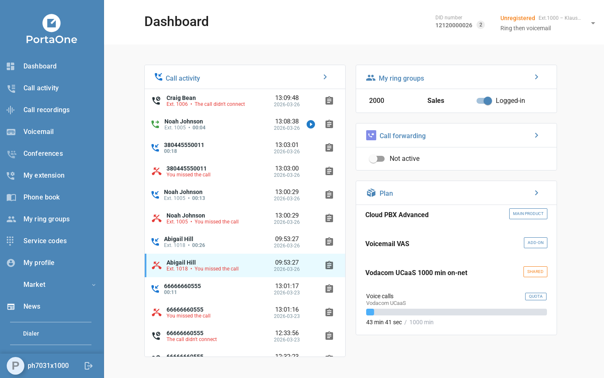
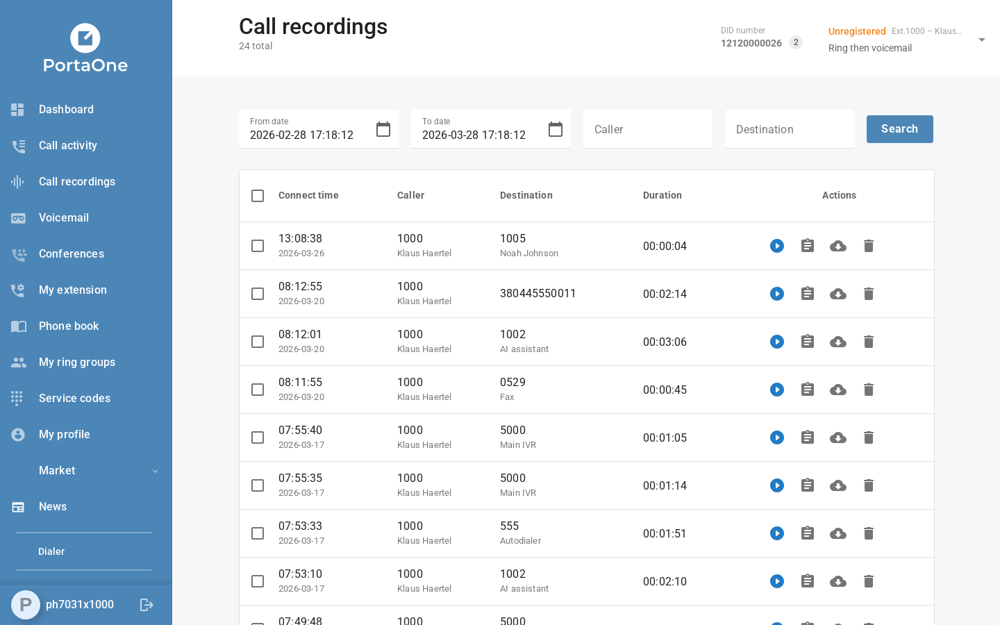
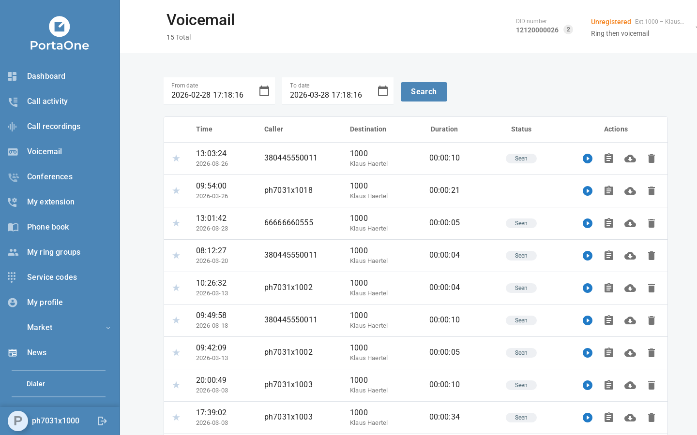

The 8.1.1 delivered the most significant new capability in the portal to date: the **End-User Self-Care Portal**, allowing individual extension owners to sign in and manage their own telephony settings independently — without involving a tenant administrator. Alongside this flagship feature, the team added **Spanish and French language support**, resolved a backlog of bugs across the Marketplace, Ring Groups, and Custom Plugins, and prepared release tags for multiple product lines.

### Flagship Feature: End-User Self-Care Portal

For the first time, **individual extension owners can sign in to the portal using their own credentials** and manage their telephony experience without involving a tenant administrator.

<!--truncate-->

### What end users can now do:

**Sign In & Navigate**

* Sign in with their extension credentials
* Access a personalized navigation menu scoped to their permitted sections
* View the UI in their preferred language
* See dates and times in their preferred regional format

**Personal Dashboard**

* See their active (live) calls in real time
* Manage call forwarding directly from a Dashboard widget
* View their current plan and bundle usage details
* Identify their account by their DID number

**Voicemail**

* Browse voicemail history with pagination
* Play back voice messages directly in the portal
* See clear messaging when voicemail is disabled on their account

**Call Recordings**

* View their call recording history
* Play and download recordings directly in the portal

**My Profile**

* Access and edit personal profile settings
* Change their default answering mode

### New Languages: Spanish & French

Both Spanish (ES) and French (FR) are now fully integrated — all UI strings, menus, tooltips, and enumerations are translated.

A high-priority fix was applied during the sprint: Spanish chart time-axis abbreviations (s, m, h, d) were not rendering correctly and were resolved immediately after discovery (ICAP-3013).

### Other Improvements

**Marketplace / Orders**

* "Cancel order" button no longer appears for already-cancelled orders
* Status filter chips can now be removed on the Orders page
* Product listing UI in Firefox no longer flickers on first load
* Price Range slider controls are correctly centered on the range line
* Reorder confirmation message updated for clarity

**Ring Groups**

* Searching ring groups by Included Extension now works correctly — the filter was completely broken (ICAP-2824)
* Fixed inconsistent minute/second format display in ring group settings

**Custom Plugins**

* Custom menu title styles now match the built-in portal style
* Plugin loading spinner is consistent across all plugin pages
* Fixed News plugin stuck in an infinite loading spinner

**Call Activity & CDR**

* Duration and Cost column headers in Recent Calls no longer overlap
* Unanswered outgoing calls are no longer misclassified as missed calls
* Transcription no longer fetched in an infinite loop when viewing call details

