This release cycle brings a substantial set of improvements to the Cloud PBX portal — from a brand-new end-user self-care experience to deeper call analytics, expanded fax management, and broader language support. The changes span portal versions **7.x.x through 8.x.x** and require **PortaSwitch MR125** or later.

### End-User Self-Care Portal

For the first time, individual extension holders — employees and end users — can log into the CloudPBX portal with their own web credentials and manage their communications directly. The service provider or business admin enables portal access per extension; once enabled, users sign in at the same URL as the business and land on a personal dashboard.

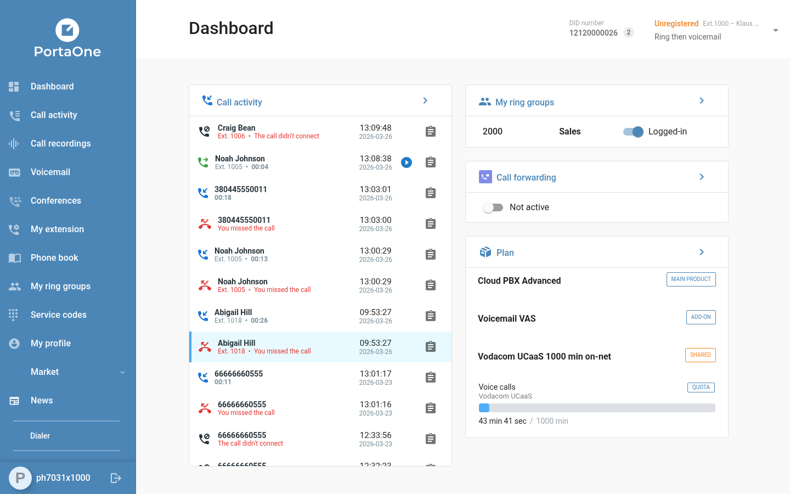

From the dashboard, end users can view their recent call activity, access call recordings, manage their extension settings (including call forwarding rules), check ring group membership, and review their active plan and services — all without involving the business admin. The dashboard itself presents this information in a clean, card-based layout: a live call activity feed on the left, and ring group status, plan summary, and service counters on the right.

Apart from the dashboard, end users can also access the Call recordings, Voicemail and My profile menus.

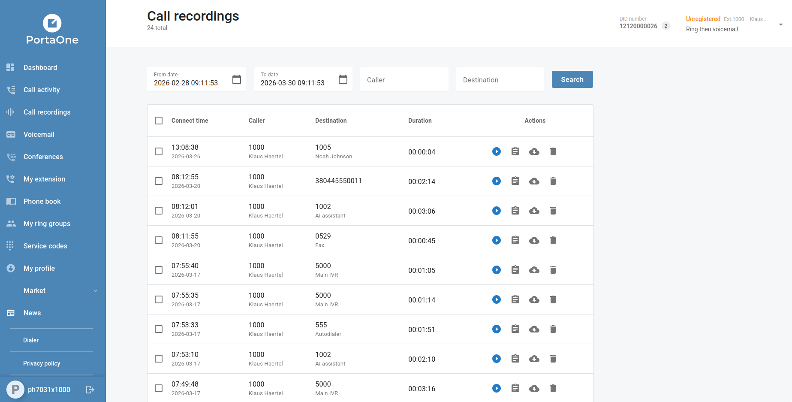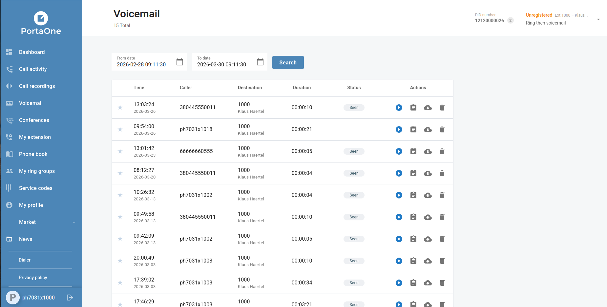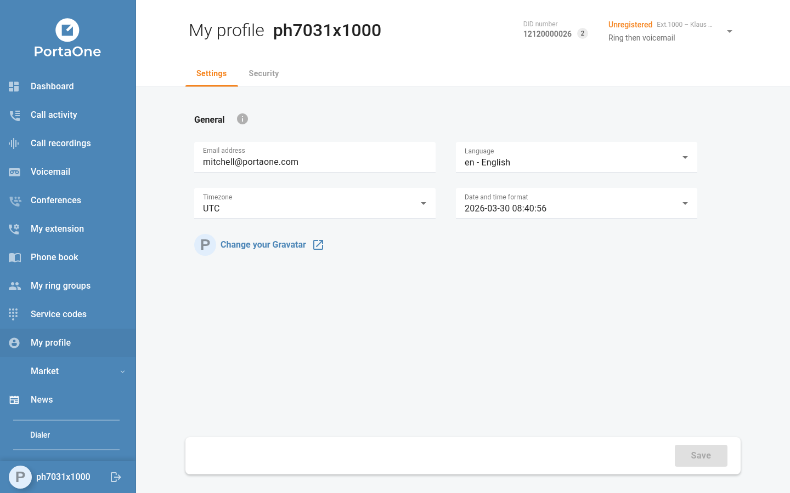

Other menus will be implemented in future versions of the CloudPBX portal.

### Fax Access

Customers can now browse, preview, and manage their incoming faxes directly from the portal. Fax messages are accessible from the fax mailbox, complete with document preview and download — no third-party email client required. Fax mailboxes are managed from the Cloud PBX → Fax mailboxes and Cloud PBX → Extensions menus, and can be assigned to DID numbers as needed.

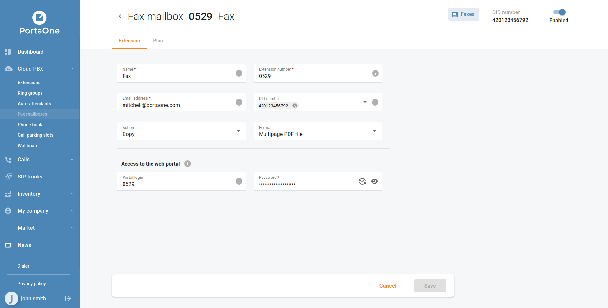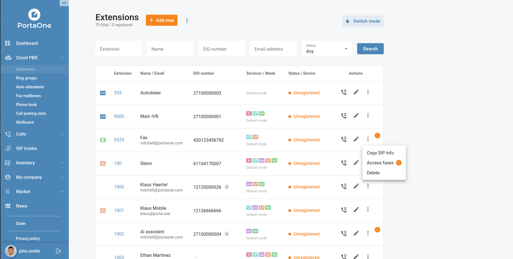
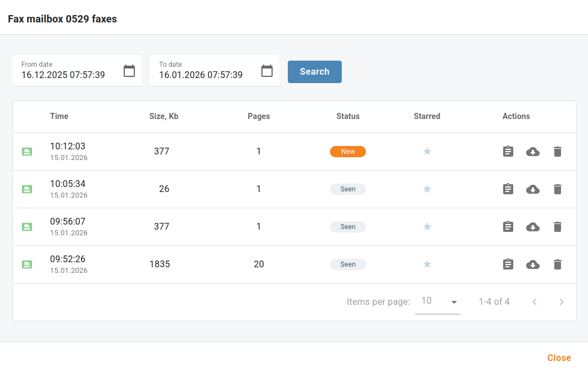
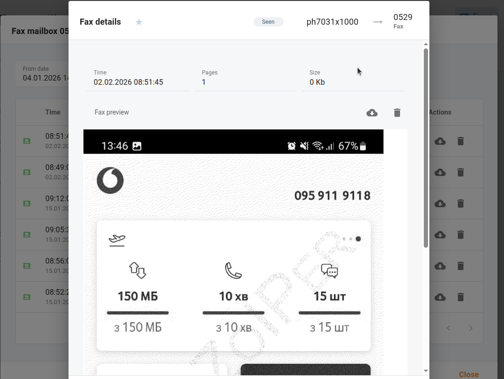

### Selectable Call Activity Metrics

The **Call activity → Call statistics** view has been enhanced with a metric selector. Four options are now available: **Connected calls**, **Talk time**, **Hold time**, and **Wrap up time**. Combined with the existing period filter and ring group filter, businesses can now build a much more targeted picture of queue and agent performance without leaving the portal.

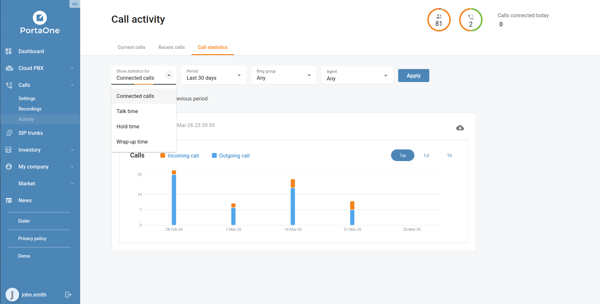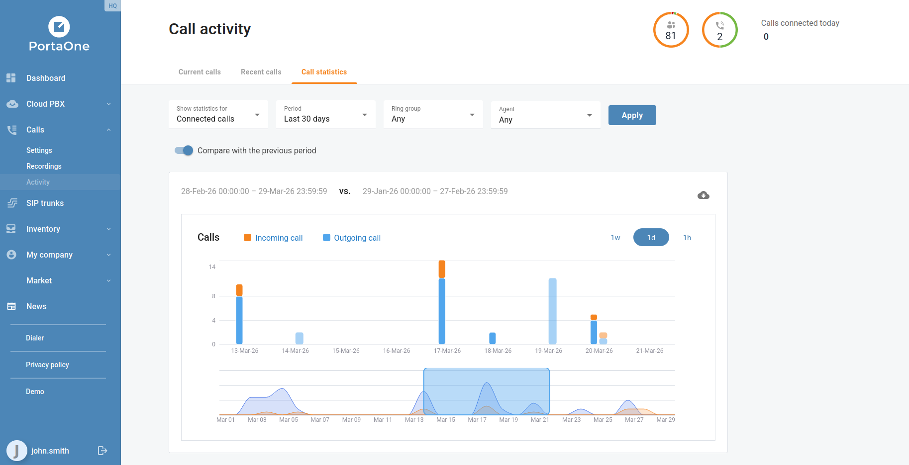

### Auto-Attendant Prompt Playback

IVR prompts can now be played back directly inside the portal without downloading the audio file. When editing an auto-attendant, each configured prompt displays an inline audio player, letting businesses verify the correct greeting, menu announcement, or error message is in place before it reaches callers. This replaces the previous workflow of downloading the audio file and opening it in a separate player.

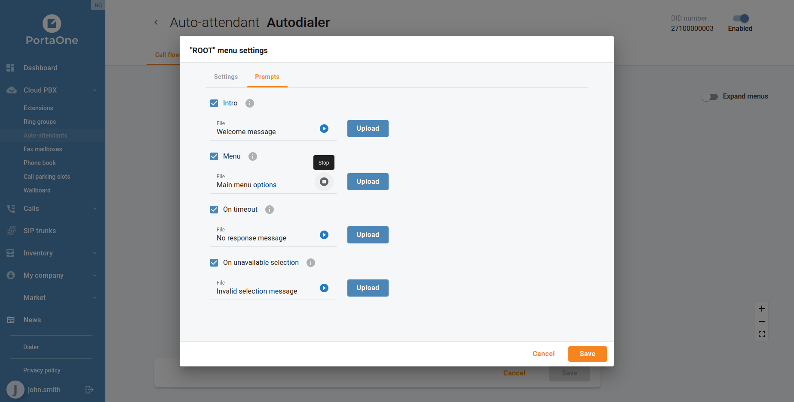

### Branch Office Extension Name and Number Updates

Branch office customers can now edit extension names and DID number assignments directly from the extension settings, without requiring a PortaBilling operator to make the change. This self-service capability reduces the time it takes to onboard new staff or update seat assignments across branch locations.

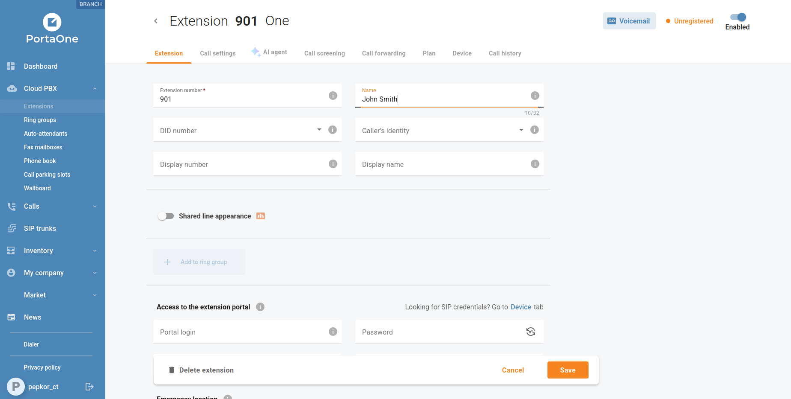

### Spanish and French Language Support

The portal interface is now available in **Spanish** and **French**, joining the existing German, Ukrainian, Croatian, Brazilian Portuguese, and Thai localizations. Users select their preferred language from **My profile → Language** — the change takes effect immediately and applies to all interface labels, status messages, and notifications.

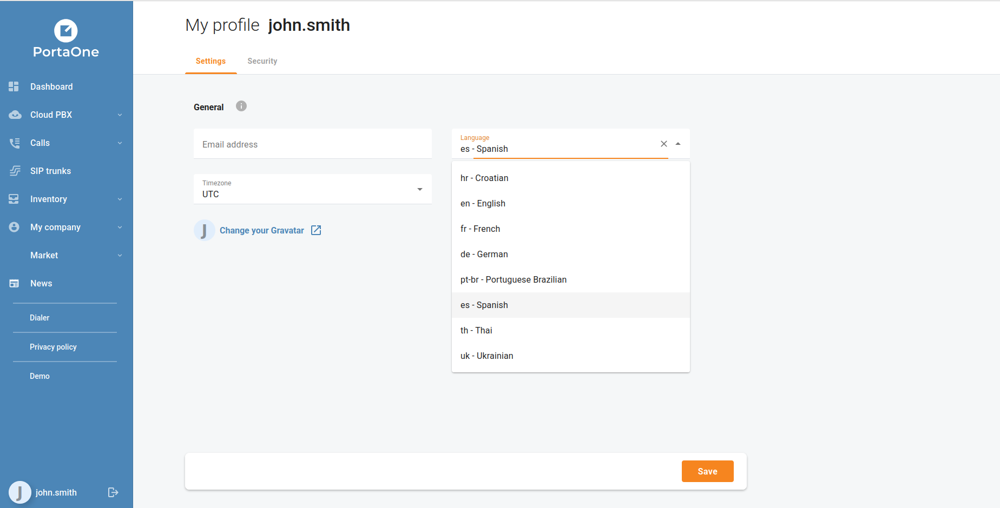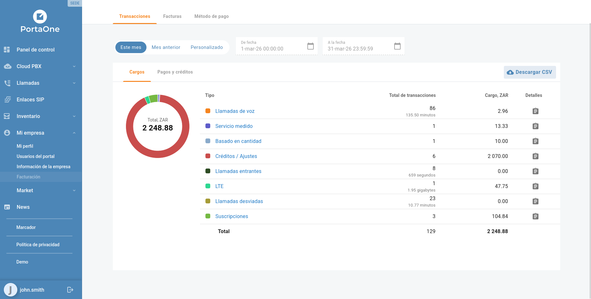

For the complete list of fixes and technical changes in each release, see the individual release notes for [7.0.0](https://portaone.github.io/cloudpbx-portal-docs/blog/release-notes-7.0.0) and [8.0.0](https://portaone.github.io/cloudpbx-portal-docs/blog/release-notes-8.0.0).

