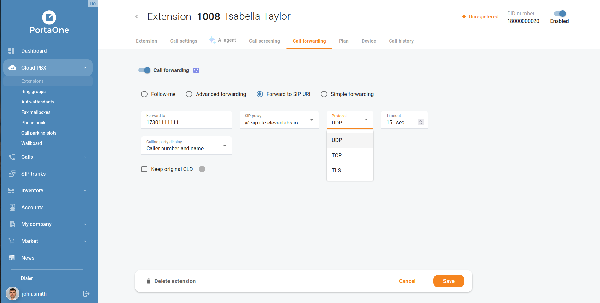
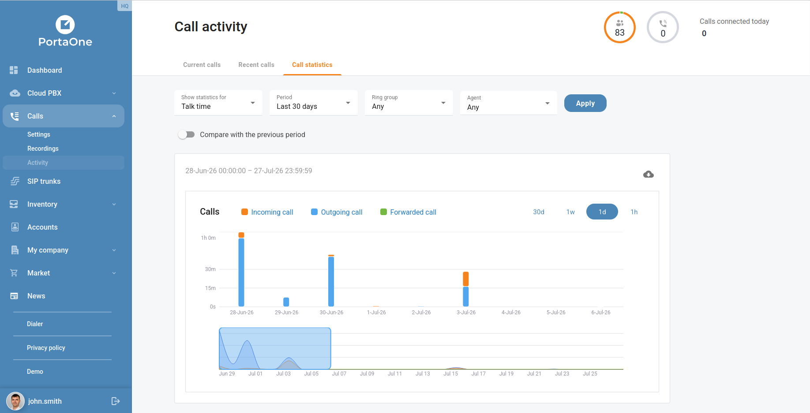
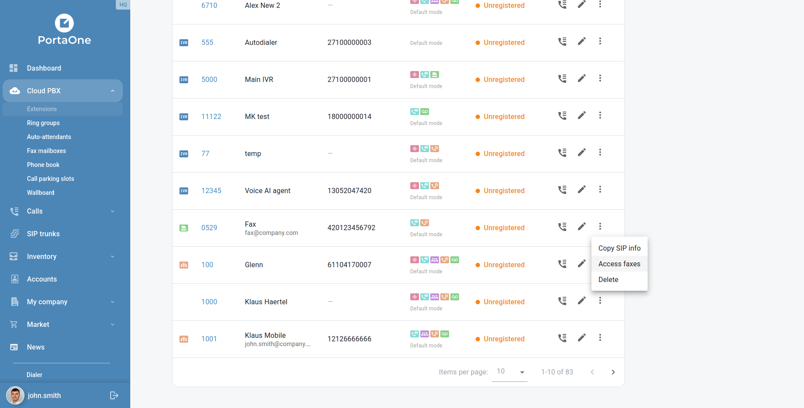

9.0.0 is an epic release that brings new functionality and bugfixes. 
Minimal PortaSwitch version is **MR127** because 9.0.0 portal requires recent PortaSwitch API to:
 - access faxes, 
 - display new call activity widget and 
 - setup TLS for forwarding. 

Please consider updating to **MR130**.

### Enhancements:
- ICAP-2773: Allow users to get call statistics for forwarded calls 
- ICAP-2841: Allow users to set TLS for forwarding rules and SIP contact
- ICAP-2871: Allow end users to access their call activity
- ICAP-2877: Allow end users to access the ring groups that they belong to
- ICAP-2880: Implement basic permissions for end users
- ICAP-2903: Allow users to access faxes from the list of extensions
- ICAP-2910: Allow users to access the Account menu
- ICAP-2929: Allow users to enable AI agents without assigned phone numbers
- ICAP-2931: Allow users to see active calls on the call statistics tab
- ICAP-2935: New style for the Sign-in page
- ICAP-2948: Convert seconds to minutes and seconds for the wrap-up timer widget of end users
- ICAP-3007: Hide the widget for end users who don't belong to any ring group
- ICAP-3060: Standardize corner rounding for various interface elements (cards, widgets, panels, tables, tooltips etc.)
- ICAP-3055: Inform end users that their settings have been updated
- ICAP-3076: Skip the login request for the Customer realm if an end user successfully changes their password
- ICAP-3080: Inconsistent page heading implementation — missing H2 tags and test attributes on several pages
- ICAP-3087: Browser auto-fills override the style of the Sign in form
- ICAP-3096: Add Accounts section translations for French and Spanish
- ICAP-3097: Add missing translation keys to French and Spanish (fr, es) — sync with EN
- ICAP-3146: Replace the spinner with the placeholder/skeleton that will be seen while waiting for a response from the voice AI adapter
- ICAP-2647: Increase the maximum extension length limit to 7

<!--truncate-->

### Bugfixes:
- ICAP-2866: Background color issue in the voicemail details for the Ukrainian localization
- ICAP-3247: The auto-attendant disconnects incoming calls due to a malformed time period
- ICAP-2887: "Date/Time" shows only time without dates if call statistics report is for several days and aggregation is less than 1 day
- ICAP-3249: Day-of-month range with spaces around the hyphen is redisplayed as separate values in the auto-attendant menu period
- ICAP-2920: Auto-attendant prompts temporarily displayed as disabled after clicking 'Save'
- ICAP-2921: Inconsistent behavior when clearing selected values with "x" button
- ICAP-2981: setInterval Memory Leak on Login
- ICAP-2982: Failure Action Never Dispatched for Extension Products
- ICAP-2983: Stale bundles Data on Dashboard
- ICAP-2984: Unhandled API Failure in editExtensionPlan Saga
- ICAP-2985: String Thrown Instead of Error Object in Paged Data Saga
- ICAP-2987: Stale Closures in FiltersComponent Effects
- ICAP-2990: Unguarded JSON.parse on localStorage
- ICAP-2991: HTTP Error Response Parsed as JSON in index.tsx
- ICAP-2996: Debug console.log left in production i18n interpolation format handler
- ICAP-3012: Call list duplicated after deleting a recording on the end-user Dashboard when a user has paginated
- ICAP-3017: Wrong column alignment on "My ring groups" widget
- ICAP-3021: Missing `yield put` in getAccountDashboardServiceFeatures catch block leaves isLoadingServiceFeatures permanently true
- ICAP-3024: Layout issue in Call recording playback panel
- ICAP-3037: y and g are cropped on End-user Dashboard widget
- ICAP-3039: Capitalized "Total" is used on end-user's "Voicemail" page
- ICAP-3041: DEFAULT_PERMISSION=false does not hide sidebar menus for end users
- ICAP-3056: Plan leads to "My profile" from end-user dashboard widget
- ICAP-3059: Let end users see which sidebar menu is opened for them
- ICAP-3071: Implement permissions for My ring groups menu of end users
- ICAP-3072: Data on the end-user profile is changed for a sec after page reloading
- ICAP-3083: Inform users that their new password is too long during the password reset
- ICAP-3085: Call activity has endless loading under end user with default API role
- ICAP-3089: Product catalogue plugin displays inconsistent card sizes for products
- ICAP-3091: Add border-radius for the left and right top corners of filters and inputs
- ICAP-3092: Add border-radius to the buttons
- ICAP-3093: Add border-radius to the badges
- ICAP-3094: Add border-radius to the dialogue that confirms discarding unsaved changes
- ICAP-3095: Remove hardcoded key screens.accounts.chargeUsd
- ICAP-3098: Decrease the width of the filters for the Ring groups menu
- ICAP-3099: clearCallRecordingIds saga mutates wrong object — cr_download_ids never cleared in state
- ICAP-3100: getMetricsDataToCompare saga dispatches wrong failure action on Axios error — compare period stuck loading
- ICAP-3101: Endless failed calls for MeasuredServices/get_customer_metrics_list and MeasuredServices/get_customer_class_metrics_list under supervisor
- ICAP-3103: Call Statistics always fails: getCallHistoryDataForStatistics accesses undefined `resCalls.response` after pagedAsyncDataRequest
- ICAP-3110: Hide the Call statistics tab in the Call activity menu of end users
- ICAP-3111: End users see the wrong currency in the call activity menu
- ICAP-3112: End users cannot open the call details they just closed
- ICAP-3113: Users see the wrong number of allowed calls aggregated for a week and 30 days
- ICAP-3114: Delete templates-new-feature directory that has a single svg image
- ICAP-3123: The timezone of an account is not updated due to a wrong API request
- ICAP-3124: Apply a bigger font size and different font colors to the account statuses
- ICAP-3125: The wrong counter is shown for the list of active accounts
- ICAP-3126: Allow users to filter account's transactions by time
- ICAP-3127: The list of account's transactions is not full
- ICAP-3128: The transaction table and the bottom panel are misaligned for the Accounts menu
- ICAP-3129: Let users see the Accounts menu name for the open browser tab
- ICAP-3130: Make dashes for missing account data grey
- ICAP-3131: Let users see how many days/months/years ago an account was last used
- ICAP-3132: Increase the width of the account filters
- ICAP-3133: Change the tooltip for the Account ID
- ICAP-3136: Wallboard call history statistics silently fails after ICAP-3111: resCalls.data.xdr_list replaces working resCalls.response.xdr_list
- ICAP-3138: Implement permissions for the Accounts menu
- ICAP-3141: Align the Add account dialog error handling with the SIP trunk form
- ICAP-3142: Stale assignAgentPhoneError causes false error toast on subsequent extension saves
- ICAP-3143: Page skeleton is opened on an attempt to access non-existent account via link
- ICAP-3144: Old ID is used in account URL after its renaming
- ICAP-3148: Debug console.log accidentally committed in AccountsList.utils.tsx
- ICAP-3155: Wallboard call history statistics always shows empty call list after incomplete ICAP-3136 fix
- ICAP-3156: Call statistics compare-period chart shows wrong max value for allowed/active calls in week and month aggregations
- ICAP-3086: Ring group names are center-aligned instead of left-aligned
- ICAP-2934: Cloud PBX sends GET voice-ai-agents request when enabling AI agent toggle
- ICAP-3104: Account dashboard peers contact list always fails: getAccountDashboardPeersContactList accesses undefined `response.response` after pagedAsyncDataRequest
- ICAP-3246: makePayment sends exp_year: "20undefined" for DirectDebitNL and other non-card payment types
