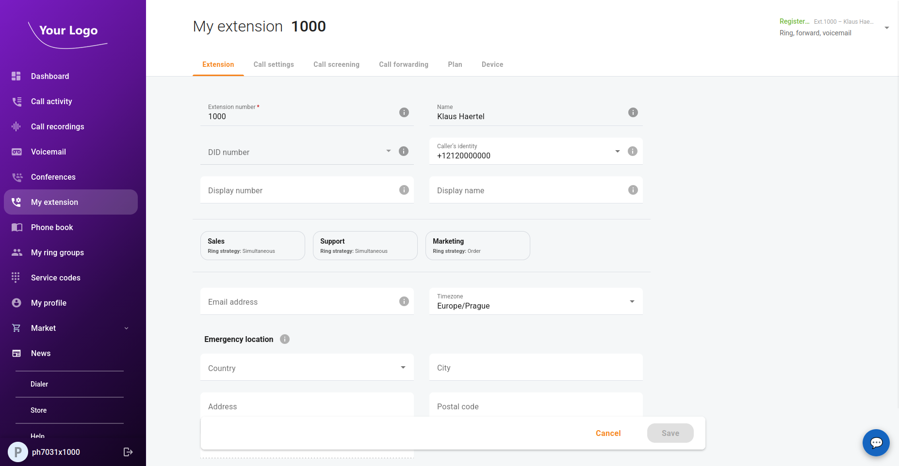
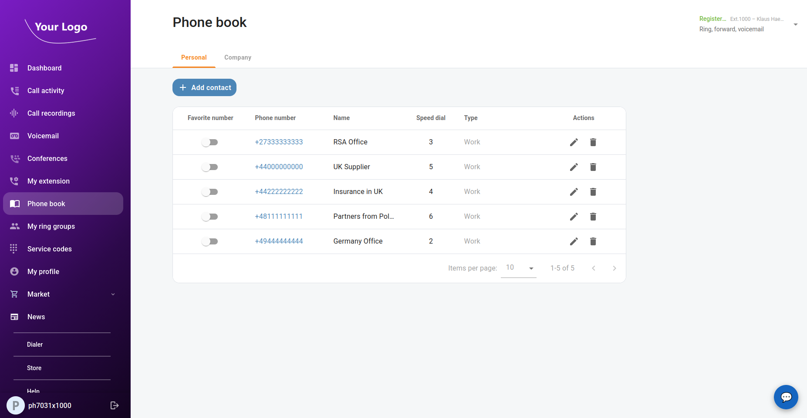
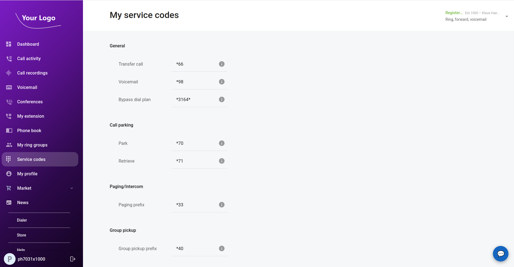

Release 9.1.0 extends the end-user portal and brings many bugfixes.
End users can now:
 - manage the settings of their own extension, 
 - manage their personal phone book and view the company phone book, 
 - look up the service codes available to them. 

Minimal PortaSwitch version is **MR127**. Please consider updating to **MR130**.

### Enhancements:
- ICAP-2875: Allow end users to manage the settings of their own extension
- ICAP-2876: Allow end users to manage their personal and business phone books
- ICAP-2878: Allow end users to access service codes
- ICAP-2900: Allow users to save multiple email addresses for fax mailboxes
- ICAP-2184: Saved prompt for new auto-attendant menu is not shown after the page is reloaded for the first time
- ICAP-3054: Add overflow protection to end user status label for long translated strings
- ICAP-3061: Customer portal header heights are inconsistent across pages
- ICAP-3147: e-payment resetting the entered amount back to the minimum payment amount configured for the payment processor
- ICAP-3170: It is hard to distinguish "Active" status for "not yet active" and "active" accounts
- ICAP-3188: Hint to hide/show CVV says "Hide/show password"
- ICAP-3322: Add the 33 missing Phone book / CVV / prompt-processing translations to Spanish and French

<!--truncate-->

### Bugfixes:
- ICAP-3342: Extension can't be adjusted due to the Call forwarding tab
- ICAP-3361: Dashboard: a call forwarding rule without a SIP proxy can't be edited, Apply does nothing
- ICAP-2979: Voicemails are not displayed when "Message delivery date" is restricted
- ICAP-2376: Data about branch office extensions not shown for supervisor of main office
- ICAP-2496: "List" icon and name of "list" rule are shown instead of the policy name if it contains such a rule
- ICAP-2529: It is unclear whether all data is fully loaded in the donuts with statistics
- ICAP-2531: User is not redirected to extension page and not user-friendly message on attempt to create an auto-attendant with the disabled service
- ICAP-2853: The pause voicemail function doesn't work properly
- ICAP-2884: User cannot copy SIP contact details or see its full value
- ICAP-2885: "Copy SIP info" is not clickable in the extensions list if "Extension details > Extension > Device" = "View only"
- ICAP-2886: Duplicated UA/get_ua_type_list sometimes are sent when opening device via link
- ICAP-2888: Period in the downloaded call statistics reports starts in the previous day because UTC time is used
- ICAP-2913: Layout issues with Voicemail and Fax buttons
- ICAP-2915: Extension name disappears when a supervisor closes the voice message details
- ICAP-2924: Show tooltips for the truncated prompt names
- ICAP-2980: Duplicate Redux Reducer Key (voicemails)
- ICAP-2986: Stale Closures in CallScreeningTab Effect
- ICAP-2988: Recursive setTimeout Memory Leak in Wallboard
- ICAP-2989: WebSocket Ping Timer Not Cleared on Unmount
- ICAP-2998: Layout issue for the filters in French
- ICAP-3001: Conditional useMemo hook calls in useVoicemails violate React Rules of Hooks
- ICAP-3003: getVoicemailList.request reducer writes to wrong state key, breaking loading indicator
- ICAP-3008: Non-localized faultstring on an attempt to set the password with Cyrillic symbols
- ICAP-3018: Confusing message is seen by a blocked end user on an attempt to log in
- ICAP-3020: ResetPassword page redirects to sign-in immediately on success, swallowing the success snackbar message
- ICAP-3022: Wrong catch variable name (`err` vs `error`) in getAccountDashboardCounters and getAccountDashboardDiscountPlanList sagas causes ReferenceError on API failure
- ICAP-3043: Voicemail loading spinner never shows — wrong key in getVoicemailList.request reducer handler
- ICAP-3046: Direct Redux state mutation via splice/index-assignment in WebSocket call-status sagas
- ICAP-3048: Newly finished call is not shown on the end user's Dashboard until page reload
- ICAP-3064: End users see the wrong date format for a while
- ICAP-3065: Unequal left margins (text indented further right) in call records display on the end-user's Dashboard
- ICAP-3069: Wrap-up timer widget stuck at 00:00 after timer expires
- ICAP-3082: Long delay and unblocked UI after max 2FA attempts exceeded
- ICAP-3105: AccountDashboard calls usePermissions inside JSX after conditional early return — React Rules of Hooks violation
- ICAP-3107: getAccountDashboardCalls saga crashes on network error — TypeError accessing faultcode on undefined apiError
- ICAP-3115, ICAP-3122: Incorrect comparison values in Call statistics chart
- ICAP-3119: The style of the same button differs between several end users' menus
- ICAP-3120: Change the size of the container that displays the password criteria
- ICAP-3137: Allowed Concurrent Calls compare-period maximum seeded with primary-period value, producing wrong chart values
- ICAP-3139: Let users see add-on products assigned to an account even if they are not part of the customer agreement
- ICAP-3140: TransactionsContent: initial fetch uses stale date filters when dialog reopens
- ICAP-3152: Wrong filter is shown for a presence widget of the wallboard
- ICAP-3153: Distance between the menu header and the counter
- ICAP-3164: New voicemails show no status in Extension list after \Recent flag removal
- ICAP-3167: Page skeleton is sometimes shown on an attempt to access non-existent trunk via link
- ICAP-3175: setExtensionStatusCall sends UI-only successMessages field to /Account/update_account API
- ICAP-3176: AI agent search dropdown may get stuck loading when user types quickly — takeLatest cancels saga but promise never settles
- ICAP-3184, ICAP-3186: Logged-in/logged-out titles duplicate toggle statuses, and the disabled state differs on the dashboard and in the ring groups list on the end-user portal
- ICAP-3187: Currency is not shown for end-user on first opening Call recording -> Call record details
- ICAP-3191, ICAP-3227: An active call does not show an extension number and name; Active Calls table shows blank caller/callee names for Retail realm users
- ICAP-3192, ICAP-3219, ICAP-3223: makePayment sends invalid exp_month/exp_year (exp_year: "20undefined") for DirectDebitNL and other non-card payment types, breaking new payment submission
- ICAP-3193: Wrong country subdivisions are shown for a payment form
- ICAP-3206: Perf: Wallboard recursive setTimeout refresh never cleaned up
- ICAP-3221: getAccountDashboardCalls saga crashes with TypeError on network error, leaving isLoadingCalls stuck at true
- ICAP-3250: getPaymentDetailsCall: decimal_digits always undefined due to incorrect selector destructuring, payment amounts always display with 2 decimal places
- ICAP-3253: Activation date field in the Add new account dialog reverts typed input and accepts past dates without validation
- ICAP-3258: SIP Trunks page shows 1800 records instead of the API total of 820
- ICAP-3260: The voicemail details modal gets stretched for long voice messages
- ICAP-3262: Auto-attendant and fax-mailbox creation shows toast + field error for legacy Server.Account.Maximum offered quantity exceeded for product ID fault
- ICAP-3263: Impossible to play back the audio with the auto-attendant's menu
- ICAP-3265: Remove unsupported preferred IVR languages
- ICAP-3267: Spanish tooltips are corrupted
- ICAP-3268: Thai: Service codes header on Call settings uses wrong term (รหัสการให้บริการ instead of รหัสบริการ)
- ICAP-3269: Broken i18n placeholders in Thai/Spanish and 6 empty strings in Croatian translations
- ICAP-3272: Voicemail button is not displayed on AA page when UM feature is enabled via Product inheritance
- ICAP-3281: Toggling a favourite in the personal phone book always reverts — setAccountPhoneBookRecordFavorit dispatches stale list
- ICAP-3282: ChangePassword shows no error when non-Latin characters are used
- ICAP-3289: End users cannot assign a new device to their own account
- ICAP-3290: The style of the badge that informs end users that their personal phone book is disabled
- ICAP-3318: The prompt is playing twice in a row
- ICAP-3323: Impossible to reopen the "Forgot your password?" page after requesting a reset link
- ICAP-3325: Supervisor panel: clicking a branch-office agent's extension leaves the page on an endless spinner
- ICAP-3326: Agents tab: the whole table is rebuilt every second, tooltips flicker
- ICAP-3339: Assigned devices tooltip instructs end users to select a device on their read-only Device tab
