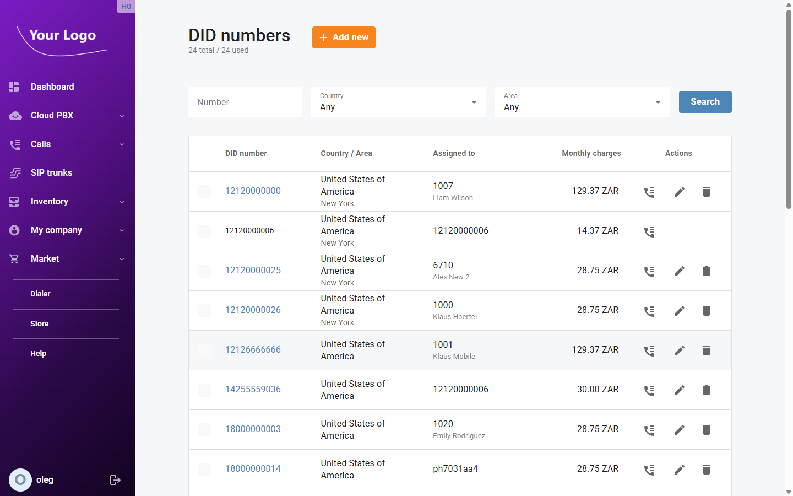
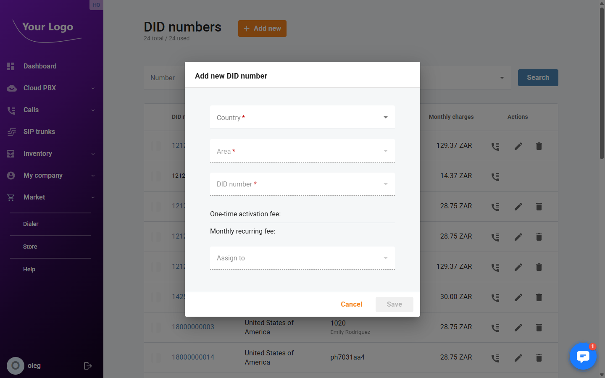
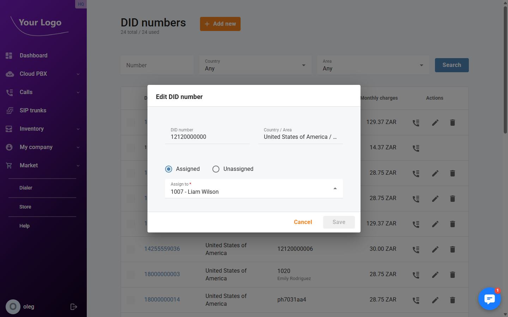

# DID Numbers

## Overview

**DID Numbers** (Direct Inward Dialling numbers) are external phone numbers assigned to your Cloud PBX. They allow callers from outside the company to reach specific extensions, ring groups, auto-attendants, or fax mailboxes directly, without going through an operator. This menu shows all DID numbers currently provisioned for your account and which phone lines they are assigned to.

Navigate to **Inventory → DID numbers**.

## DID Numbers List

| Column | Description |
|---|---|
| **DID number** | The provisioned phone number in international format. |
| **Country / Area** | The country and geographic area the number belongs to. |
| **Assigned to** | The phone line (extension, ring group, auto-attendant, or fax mailbox) the number is routed to. Shows *Not assigned* if unassigned. |
| **Actions** | **Edit** (✏️) – assign or reassign the number; **Delete** (🗑️) – return the number to the provider. |

Use the **Number**, **Country**, and **Area** filters to search. Click **Search** to apply.

Click **+ Add new** to activate a new DID number.

## Adding a DID Number

1. Select the **Country** from the dropdown.
2. Select the **Area** — the available areas are filtered by the selected country.
3. Select a **DID number** from the available numbers in that area.

:::note
For some areas it is not possible to pre-select a specific number. If no number selector appears, clicking **Save** will assign the first available number in that area automatically.
:::

The **Fees** section displays the charges associated with the selected number:

| Field | Description |
|---|---|
| **One-time activation fee** | A single charge billed when the number is first activated. |
| **Monthly recurring fee** | The ongoing monthly fee for keeping the number provisioned. |

Optionally, use the **Assign to** dropdown to assign the new number to an extension, ring group, auto-attendant, or fax mailbox immediately. You can also assign it later.

Click **Save** to activate the number.

## Assigning a DID Number

To assign or reassign an existing DID number to a phone line, click **Edit** (✏️) next to the number.

| Field | Description |
|---|---|
| **DID number** | The provisioned number (read-only). |
| **Country and area** | The country and area of the number (read-only). |
| **Assigned to** | Select the phone line to route incoming calls to. Use the radio button to switch between assigning to a phone line and leaving the number unassigned. |

Click **Save** to apply the assignment.

## Deleting a DID Number

To return a DID number to your service provider, click **Delete** (🗑️) next to the number and confirm.

:::note
Deleting a DID number immediately unassigns it from any phone line and removes it from your account. This action cannot be undone.
:::
